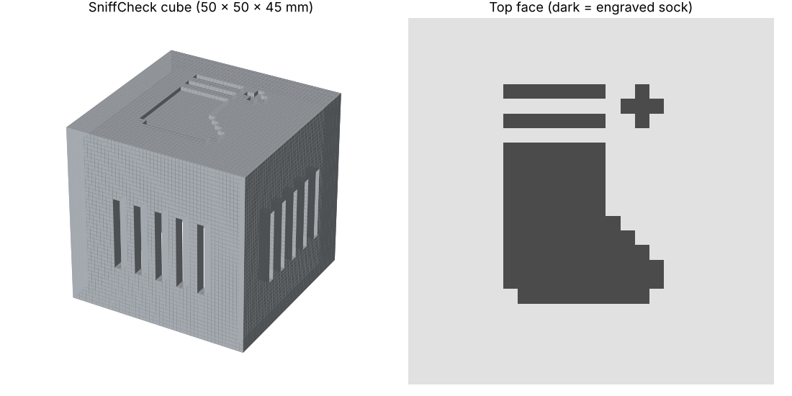

# SniffCheck 🧦✨

**A pocket-sized smell sensor that tells you whether your feet stink — before anyone else notices.**

Built at Cal Hacks 13.0.

Most people can't smell themselves (our noses get used to our own smell), and many people lost some or all of their sense of smell after COVID. SniffCheck gives them a private, kind way to check.

## How it works

1. Place the SniffCheck cube over a shoe or sock.
2. A gas sensor inside "sniffs" the air and compares it to clean air.
3. You get a **Stink Score from 0 to 100**: 🌸 Fresh, 🤔 Hmm…, 😬 Stinky or ☣️ Biohazard.
4. A buzzer beeps when it's stinky, and the web app shows a live meter.
5. Tap **✨ Ask Claude** for 3 friendly, personal tips based on your score.

## Hardware

- Arduino UNO R4 WiFi
- Grove Base Shield (set to 5V)
- Grove Air Quality Sensor v1.3 → port **A0**
- Grove Buzzer → port **D8**
- 3D-printed cube case (`sniffcheck_cube.stl`, prints in ~1 hour on a Bambu P1S, no supports)

## Files

| File | What it is |
|---|---|
| `stink_sensor.ino` | Arduino code: warm-up, clean-air calibration, Stink Score, buzzer alerts |
| `index.html` | Web app: live meter over Web Serial + Claude tips |
| `sniffcheck_cube.stl` | 3D-printable case with a pixel-sock logo |

## Run it

1. Open `stink_sensor.ino` in the Arduino IDE, select **Arduino UNO R4 WiFi**, and upload.
2. Close the Arduino Serial Monitor.
3. Open `index.html` in **Google Chrome** (Web Serial needs Chrome).
4. Click **Connect sensor** and choose the UNO R4 port.
5. Optional: open **Settings** in the app and paste your own Claude API key to turn on Claude tips. The key is stored only in your browser — it is never in this code.

## Built with

Arduino · Grove · JavaScript · HTML/CSS · Web Serial API · Claude API (Anthropic) · Bambu Studio · 3D printing
